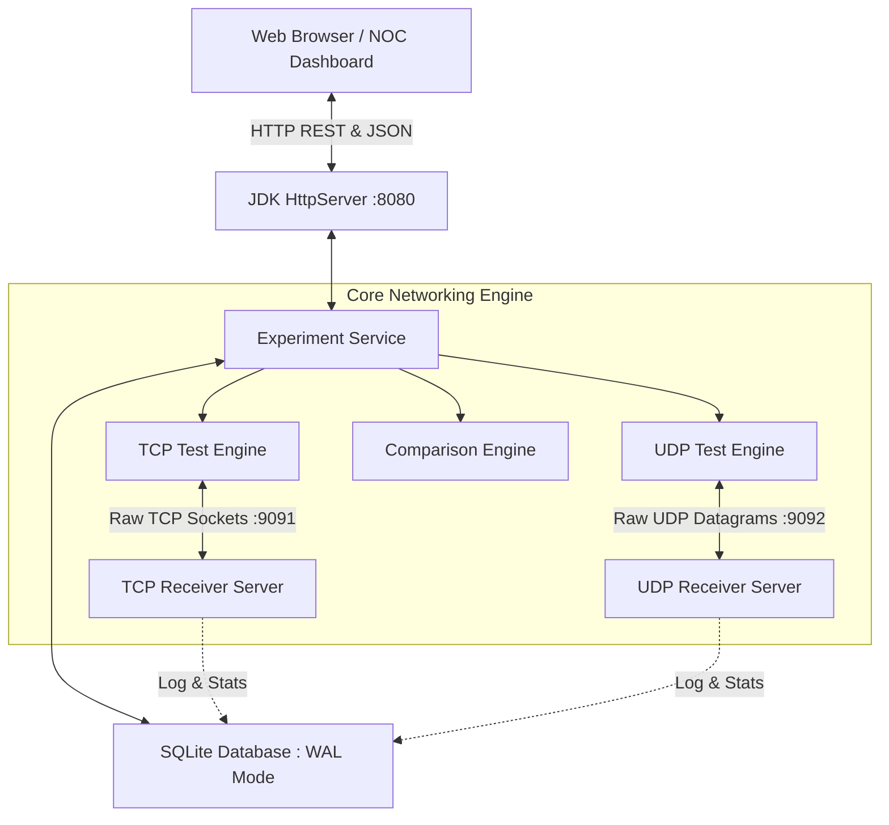
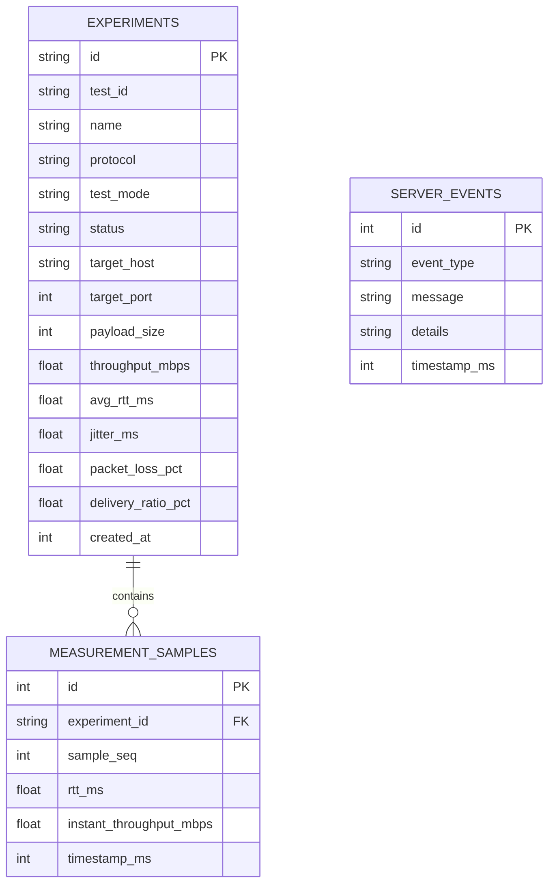

# Network Performance Analyzer — Architecture Specification

## 1. System Overview

The Network Performance Analyzer is a modular, client-server performance testing laboratory designed to evaluate transport layer protocols (TCP and UDP) under configurable network loads.



---

## 2. Binary Protocol Framing

To prevent partial reads, payload corruption, and packet mixups, both TCP streams and UDP datagrams utilize a strict, versioned 44-byte binary header followed by application payload:

```text
 0                   1                   2                   3
 0 1 2 3 4 5 6 7 8 9 0 1 2 3 4 5 6 7 8 9 0 1 2 3 4 5 6 7 8 9 0 1
+-+-+-+-+-+-+-+-+-+-+-+-+-+-+-+-+-+-+-+-+-+-+-+-+-+-+-+-+-+-+-+-+
|       Magic (0x4E50 'NP')     |  Version (01) | Msg Type (01) |
+-+-+-+-+-+-+-+-+-+-+-+-+-+-+-+-+-+-+-+-+-+-+-+-+-+-+-+-+-+-+-+-+
|                                                               |
+                    Test Identifier UUID                       +
|                          (16 Bytes)                           |
+-+-+-+-+-+-+-+-+-+-+-+-+-+-+-+-+-+-+-+-+-+-+-+-+-+-+-+-+-+-+-+-+
|                                                               |
+                    Sequence Number (64-bit)                   +
|                                                               |
+-+-+-+-+-+-+-+-+-+-+-+-+-+-+-+-+-+-+-+-+-+-+-+-+-+-+-+-+-+-+-+-+
|                                                               |
+                    Sender Timestamp (64-bit)                  +
|                                                               |
+-+-+-+-+-+-+-+-+-+-+-+-+-+-+-+-+-+-+-+-+-+-+-+-+-+-+-+-+-+-+-+-+
|                     Payload Length (32-bit)                   |
+-+-+-+-+-+-+-+-+-+-+-+-+-+-+-+-+-+-+-+-+-+-+-+-+-+-+-+-+-+-+-+-+
|                     CRC-32 Checksum (32-bit)                  |
+-+-+-+-+-+-+-+-+-+-+-+-+-+-+-+-+-+-+-+-+-+-+-+-+-+-+-+-+-+-+-+-+
|                     Application Payload Data ...              |
+-+-+-+-+-+-+-+-+-+-+-+-+-+-+-+-+-+-+-+-+-+-+-+-+-+-+-+-+-+-+-+-+
```

### Message Types

- `0x01`: `HANDSHAKE`
- `0x02`: `HANDSHAKE_ACK`
- `0x03`: `RTT_REQUEST`
- `0x04`: `RTT_RESPONSE`
- `0x05`: `BULK_DATA`
- `0x06`: `BULK_ACK`
- `0x07`: `STATUS_QUERY`
- `0x08`: `STATUS_REPLY`
- `0x09`: `TERMINATE`

---

## 3. Communication Sequence Diagrams

### 3.1 TCP Communication Sequence

```mermaid
sequenceDiagram
    autonumber
    participant Client as TCP Test Engine
    participant Server as TCP Receiver (:9091)
    
    Client->>Server: Connect (Measure Connection Setup Latency)
    Server-->>Client: Connection Established
    
    rect rgb(20, 35, 60)
        Note over Client, Server: Warm-up Phase (Configurable)
        Client->>Server: Framed RTT_REQUEST (Warmup Packet)
        Server-->>Client: Framed RTT_RESPONSE (Echo)
    end
    
    rect rgb(15, 30, 50)
        Note over Client, Server: Measurement Phase (RTT or Bulk)
        loop For Each Sample
            Client->>Server: Framed RTT_REQUEST / BULK_DATA (Seq #i, Timestamp, Payload)
            Server-->>Client: Framed RTT_RESPONSE (Echo for RTT Mode)
        end
        Client->>Server: TERMINATE Packet
        Server-->>Client: BULK_ACK (Total Packets, Total Bytes, Duration)
    end
    
    Client->>Server: Close Socket
```



### 3.2 UDP Communication Sequence

```mermaid
sequenceDiagram
    autonumber
    participant Client as UDP Test Engine
    participant Server as UDP Receiver (:9092)
    
    rect rgb(20, 35, 60)
        Note over Client, Server: RTT / Datagram Stream
        loop Configured Packets (Paced or Unthrottled)
            Client->>Server: Datagram [Header(Seq #i, TestId, CRC) + Payload]
            opt In RTT Mode
                Server-->>Client: Datagram Echo [RTT_RESPONSE, Seq #i]
            end
        end
    end
    
    rect rgb(15, 30, 50)
        Note over Client, Server: Verification & Accounting
        Client->>Server: Datagram [STATUS_QUERY, TestId]
        Server-->>Client: Datagram [STATUS_REPLY (Total, Unique, Duplicate, Out-of-Order)]
    end
```



---

## 4. SQLite Database Architecture

Persistent storage uses SQLite with Write-Ahead Logging (`PRAGMA journal_mode=WAL`) to allow concurrent reads during background testing.


